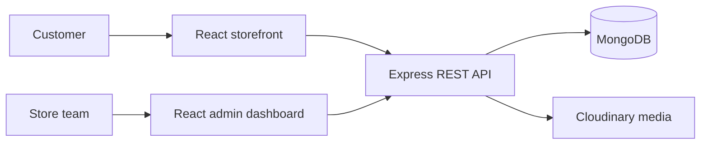
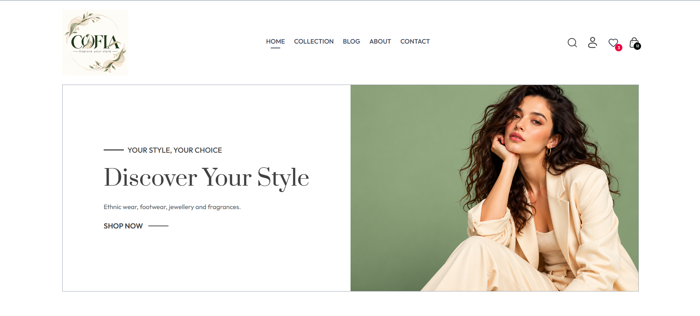
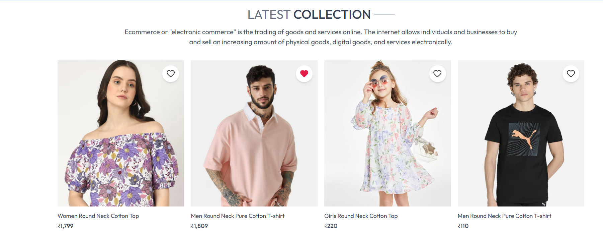
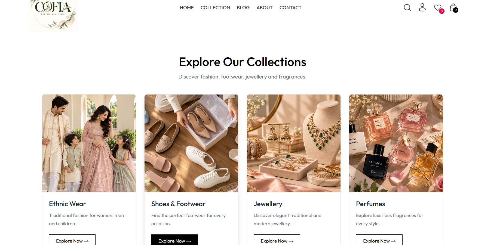

<div align="center">

# COFIA — Explore Your Style

**A modern fashion storefront for clothing, footwear, jewellery, and fragrances.**

Discover curated collections, browse products, and shop from a responsive storefront backed by an admin dashboard and API.

[](https://cofia-ochre.vercel.app)


</div>

## Contents

- [Overview](#overview)
- [Features](#features)
- [Architecture](#architecture)
- [Technology](#technology)
- [Project structure](#project-structure)
- [Run locally](#run-locally)
- [Deployment](#deployment)
- [Security](#security)
- [Screenshots](#screenshots)
- [License](#license)

## Overview

COFIA is a full-stack fashion commerce project with three applications: a customer storefront, an admin dashboard, and a REST API. It brings clothing, footwear, jewellery, and fragrance collections into one shopping experience. The storefront and admin are built with React and Vite; the API uses Express and MongoDB, with Cloudinary support for product media.

**Live demo:** [cofia-ochre.vercel.app](https://cofia-ochre.vercel.app)

## Features

- Browse clothing, shoes and footwear, jewellery, and perfume collections.
- Search products and view product details.
- Save favourites to a wishlist and manage a shopping cart.
- Sign in, place orders, and review order history.
- Manage products and orders through the admin dashboard.
- Use the storefront on desktop and mobile screens.

## Architecture



## Technology

| Application | Stack |
|---|---|
| Storefront | React, Vite, JavaScript |
| Admin dashboard | React, Vite, JavaScript |
| API | Node.js, Express |
| Database | MongoDB, Mongoose |
| Product media | Cloudinary |
| Current storefront hosting | Vercel |

## Project structure

```text
COFIA/
├── frontend/     # Customer storefront and product assets
├── admin/        # Admin dashboard
├── backend/      # Express API, routes, models, and integrations
└── screenshots/  # README preview images
```

## Run locally

### Prerequisites

- Node.js and npm
- A MongoDB connection string
- A Cloudinary account for image uploads

### Install dependencies

Run these commands from the repository root:

```powershell
cd frontend; npm install
cd ../admin; npm install
cd ../backend; npm install
```

### Configure environment variables

Create `backend/.env` using the keys in [`backend/.env.example`](backend/.env.example). For local storefront development, create `frontend/.env`:

```env
VITE_BACKEND_URL=http://localhost:4000
```

Set the same `VITE_BACKEND_URL` in `admin/.env`. Keep real credentials in local environment files; do not commit them.

### Start the applications

Open three terminals from the repository root:

```powershell
# Terminal 1 — API
cd backend; npm run dev
```

```powershell
# Terminal 2 — storefront
cd frontend; npm run dev
```

```powershell
# Terminal 3 — admin dashboard
cd admin; npm run dev
```

Vite prints the local URLs for the storefront and admin dashboard. The API uses the configured port or port `4000` by default.

## Deployment

The customer storefront is deployed at **[cofia-ochre.vercel.app](https://cofia-ochre.vercel.app)**. The API and admin dashboard require their own Vercel projects if you want to deploy the complete stack. Set each project's root directory to `backend`, `admin`, or `frontend`, as appropriate.

1. Add the backend production environment variables in the API project's Vercel settings.
2. Deploy the API and copy its production URL.
3. Set `VITE_BACKEND_URL` to the API URL in the storefront and admin projects, then redeploy them.
4. Verify sign-in, product loading, cart, and admin API behavior.

## Security

- Real `.env` files are excluded from Git; commit only `.env.example` templates.
- Keep production credentials in Vercel environment settings or another secure secret store.
- Never place database passwords, JWT secrets, or Cloudinary API secrets in a `VITE_` variable. Vite includes these values in the browser bundle.
- Restrict database access to trusted services and rotate credentials if exposed.

## Screenshots

<p align="center">
  
  
</p>

<p align="center">
  
</p>

## License

No license has been selected. All rights are reserved unless a license is added to this repository.
